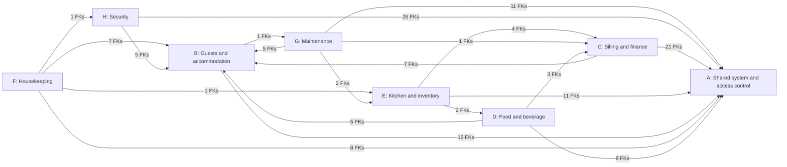
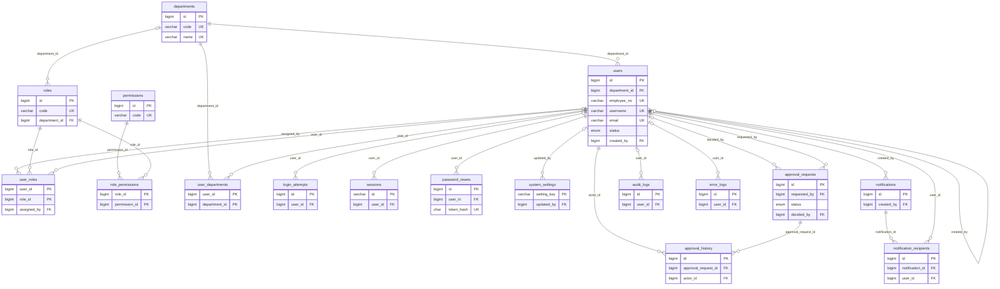
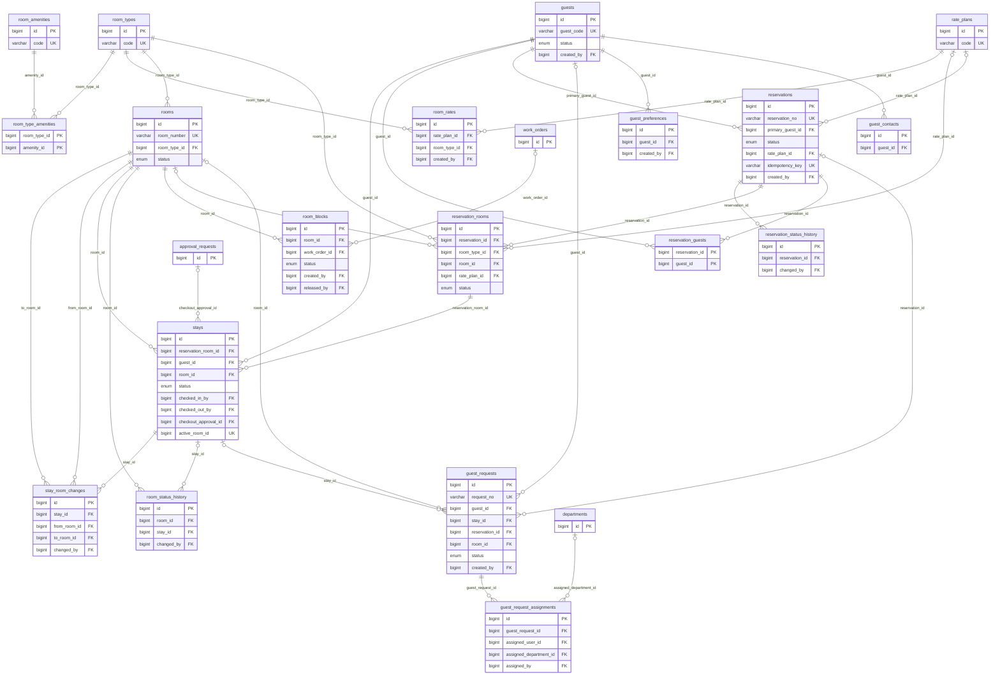
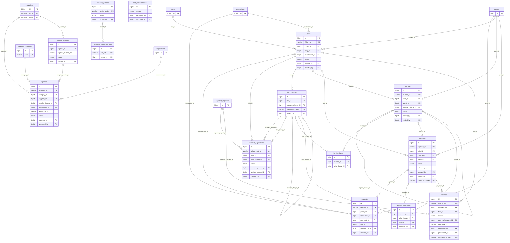
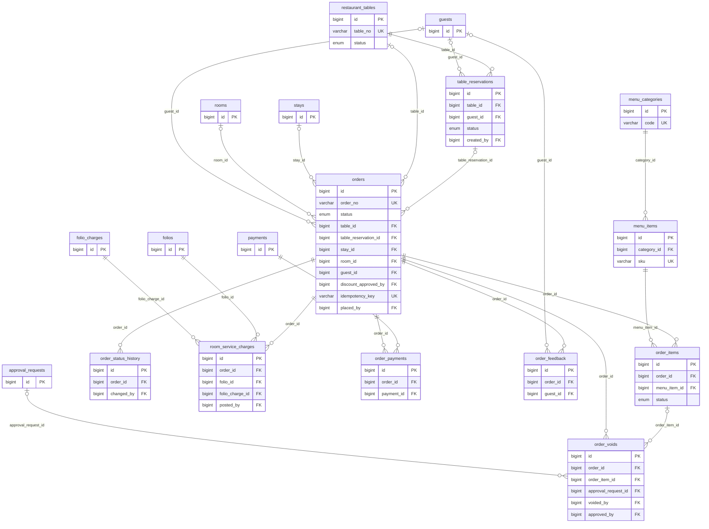
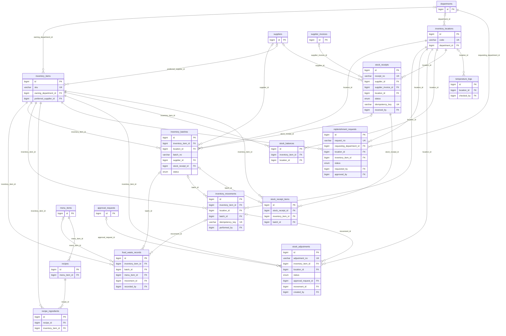
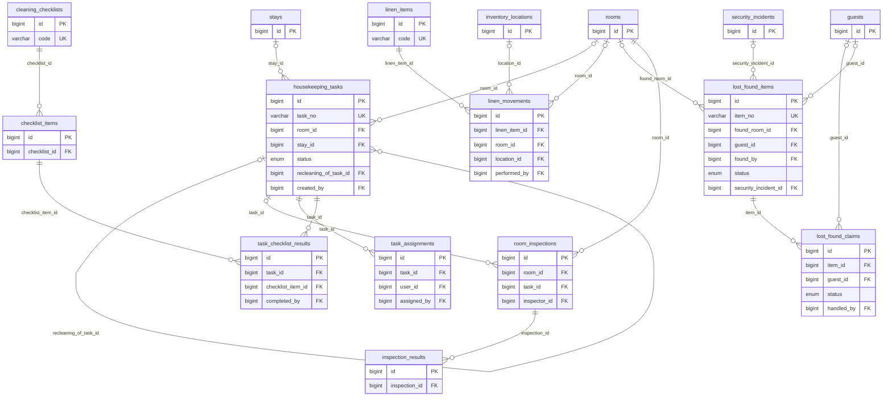
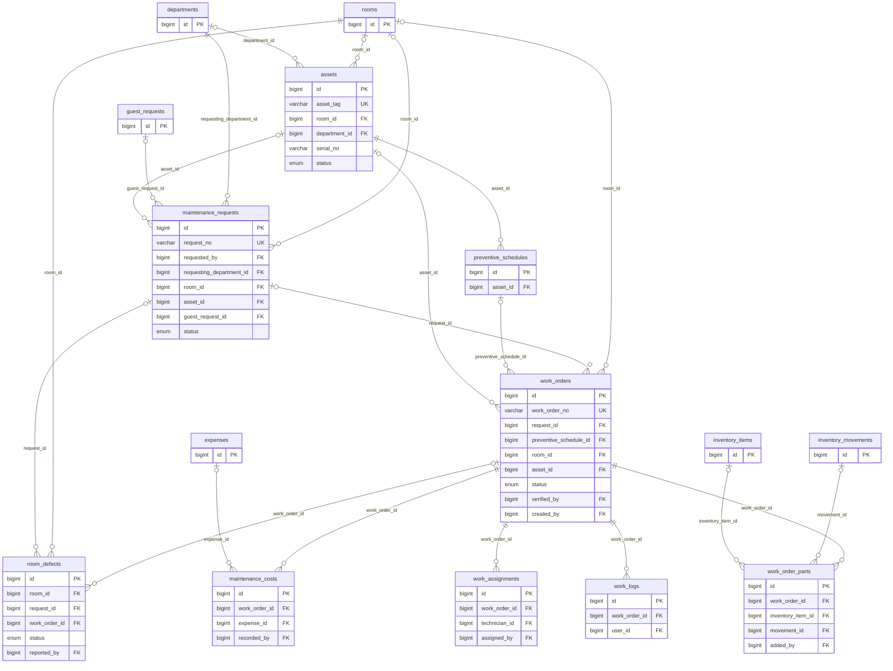

# IHMS Entity-Relationship Diagrams

_Generated from the live database. Open in VS Code (Markdown Preview Mermaid Support), GitHub, or paste the `.mmd` files at mermaid.live. Tables from another group appear only as small reference boxes. Links from actor columns (`created_by`, `changed_by`, `recorded_by`, ...) to `users` are listed in each table but not drawn, to keep the diagrams readable._

## How the groups connect

---

## Group A: Shared system and access control (17 tables)

---

## Group B: Guests and accommodation (19 tables)

---

## Group C: Billing and finance (16 tables)

---

## Group D: Food and beverage (11 tables)

---

## Group E: Kitchen and inventory (13 tables)

---

## Group F: Housekeeping (11 tables)

---

## Group G: Maintenance (9 tables)

---

## Group H: Security (27 tables)

```mermaid
erDiagram
  security_incidents {
    bigint id PK
    varchar incident_no UK
    enum status 
    bigint room_id FK
    bigint guest_id FK
    bigint reported_by FK
  }
  incident_updates {
    bigint id PK
    bigint incident_id FK
    bigint created_by FK
  }
  incident_assignments {
    bigint id PK
    bigint incident_id FK
    bigint assigned_to FK
    bigint assigned_by FK
  }
  visitor_logs {
    bigint id PK
    bigint host_guest_id FK
    bigint host_user_id FK
    bigint stay_id FK
    bigint room_id FK
    varchar badge_no 
    enum status 
    bigint checked_in_by FK
    bigint checked_out_by FK
  }
  guard_shifts {
    bigint id PK
    bigint guard_user_id FK
    enum status 
  }
  shift_handovers {
    bigint id PK
    bigint from_shift_id FK
    bigint to_shift_id FK
    bigint from_user_id FK
    bigint to_user_id FK
  }
  patrol_schedules {
    bigint id PK
  }
  patrol_checkpoints {
    bigint id PK
    varchar code UK
    smallint sequence_no 
  }
  patrol_records {
    bigint id PK
    bigint patrol_schedule_id FK
    bigint guard_shift_id FK
    bigint checkpoint_id FK
    bigint guard_user_id FK
    enum status 
  }
  cctv_references {
    bigint id PK
    bigint incident_id FK
    bigint recorded_by FK
  }
  safety_inspections {
    bigint id PK
    bigint inspected_by FK
  }
  incidents {
    bigint id PK
    enum status 
    bigint reported_by FK
    bigint assigned_to FK
    varchar room_no 
  }
  security_app_incident_updates {
    bigint id PK
    bigint incident_id FK
    bigint user_id FK
    enum status 
  }
  security_staff {
    bigint id PK
    varchar staff_no UK
    enum status 
  }
  cctv_cameras {
    bigint id PK
    varchar name UK
    enum status 
    char browser_device_key UK
    bigint added_by FK
  }
  cctv_refs {
    bigint id PK
    bigint incident_id FK
    bigint added_by FK
  }
  visitors {
    bigint id PK
    varchar room_no 
    bigint logged_by FK
  }
  patrol_logs {
    bigint id PK
    bigint patrolled_by FK
  }
  shift_schedule {
    bigint id PK
    bigint staff_id FK
  }
  checkpoints {
    bigint id PK
    varchar name UK
  }
  patrol_schedule {
    bigint id PK
  }
  fire_inspections {
    bigint id PK
    bigint inspected_by FK
  }
  key_logs {
    bigint id PK
    bigint issued_by FK
  }
  restricted_access {
    bigint id PK
    bigint logged_by FK
  }
  emergencies {
    bigint id PK
    enum status 
    bigint reported_by FK
  }
  case_notes {
    bigint id PK
    bigint user_id FK
    varchar status 
  }
  security_sso_tickets {
    char ticket_id PK
    bigint user_id FK
  }
  guests {
    bigint id PK
  }
  rooms {
    bigint id PK
  }
  stays {
    bigint id PK
  }
  security_incidents |o--o{ cctv_references : "incident_id"
  incidents ||--o{ cctv_refs : "incident_id"
  security_incidents ||--o{ incident_assignments : "incident_id"
  security_incidents ||--o{ incident_updates : "incident_id"
  patrol_checkpoints ||--o{ patrol_records : "checkpoint_id"
  guard_shifts |o--o{ patrol_records : "guard_shift_id"
  patrol_schedules |o--o{ patrol_records : "patrol_schedule_id"
  incidents ||--o{ security_app_incident_updates : "incident_id"
  guests |o--o{ security_incidents : "guest_id"
  rooms |o--o{ security_incidents : "room_id"
  guard_shifts ||--o{ shift_handovers : "from_shift_id"
  guard_shifts |o--o{ shift_handovers : "to_shift_id"
  security_staff ||--o{ shift_schedule : "staff_id"
  guests |o--o{ visitor_logs : "host_guest_id"
  rooms |o--o{ visitor_logs : "room_id"
  stays |o--o{ visitor_logs : "stay_id"
```

